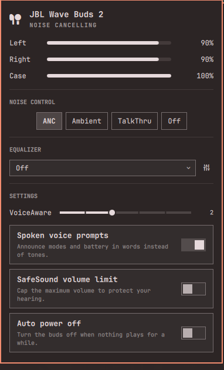

# JBL Control for Omarchy

JBL earbuds and headphones in the [Omarchy](https://omarchy.org/) bar: left/right/case battery,
noise cancelling / Ambient Aware / TalkThru, EQ, VoiceAware and the rest of the JBL Headphones
app's settings, with no phone and no app.



## Features

- **Battery.** Left, right and case, with charging state, plus a low-battery notification.
  The bar shows the emptier bud.
- **Noise control.** Off / Noise Cancelling / Ambient Aware / TalkThru, and the ANC level on
  models that have one. Scroll on the bar icon (or middle-click) to cycle modes. An OSD shows
  every change, including ones from the buds' own touch control.
- **Equalizer.** Jazz, Vocal, Bass, Club, Studio and Extreme Bass presets, Off, and a custom
  10-band curve (32 Hz–16 kHz, ±6 dB).
- **Settings.** VoiceAware level, spoken voice prompts, SafeSound volume limit, auto power-off,
  spatial sound and low latency. Each one appears only if your model answers for it.
- **Find My Buds.** Ring the left or right bud.
- **Power off.** Press the power button twice to confirm.
- **`jblctl`.** Everything above from a terminal or a Hyprland keybinding.

The panel shows only what your model actually supports. When you open it, the plugin asks the
buds for each setting. Anything they don't answer stays hidden. If the buds quietly decline a
change, the plugin tells you so instead of pretending it worked. For example, a Wave Buds 2
refuses ANC while one bud is still in the case.

## Supported headphones

| Model | Status |
|---|---|
| JBL Wave Buds 2 | Verified on hardware (firmware 2.7.0): battery, all four modes, EQ, VoiceAware, prompts, SafeSound, auto-off, Find My Buds |
| Vibe Buds 2, Tune Flex 2, Tune Buds 2, Tune Beam 2, Wave Flex 2, Tune 230NC/255NC, Live 660/770NC, Tour Pro 2 | Same protocol per the references below. Should work; features are discovered per model |
| Original Wave Buds (gen 1) | Battery works. Controls appear if the buds expose the control service; there's no ANC hardware |
| Gen-3 lines (Tune 680/780NC, Live x80NC, Tour Pro 4, …) | Battery only. They use a newer protocol that hasn't been decoded yet |

Have a model that's not listed? Run `tools/jbl-probe` and open an issue with the output.

## Install

```bash
omarchy plugin add https://github.com/AhmadRun/jbl-control --enable
```

Pair the headphones first, as usual (Omarchy's Bluetooth menu or `bluetoothctl`). This plugin
doesn't do pairing.

## Remove

```bash
omarchy plugin remove io.github.ahmadrun.jbl-control
```

## Dependencies

All of these come with a stock Omarchy install:

- Python 3.14+ (stdlib)
- `python-dbus`
- `python-gobject`
- BlueZ
- `notify-send`

## Usage

- **Click** the bar icon to open the panel.
- **Scroll** or **middle-click** the icon to cycle listening modes.
- **`m`** in the panel cycles modes too.

From a terminal:

```bash
jblctl                       # status
jblctl mode anc              # off | anc | ambient | talkthru | cycle [list]
jblctl eq preset bass        # eq off | eq preset <name> | eq custom g1,...,g10 | eq band <i> <dB>
jblctl voice-aware 3         # 0 (off) .. 5
jblctl find left             # left | right | both | stop
jblctl help                  # every command
```

`jblctl` lives in the plugin's `bin/` folder:
`~/.config/omarchy/plugins/io.github.ahmadrun.jbl-control/bin/jblctl`.

### Hyprland keybinding

Add to `~/.config/hypr/bindings.lua`. This cycles modes through the widget and shows the OSD:

```lua
o.bind("SUPER + CTRL + A", "Cycle headphone noise control", "omarchy-shell io.github.ahmadrun.jbl-control cycleAnc")
```

IPC methods on `io.github.ahmadrun.jbl-control`:

- `open`, `close`, `toggle`
- `cycleAnc`
- `setMode <mode>`
- `findBuds <left|right|both|stop>`
- `command "<any jblctl command>"`

## Settings

| Setting | Default | |
|---|---|---|
| Headphones address | empty | Which JBL device to control. Empty means whichever is connected |
| Show battery in the bar | on | |
| Modes to cycle | ANC, Ambient, Off | What scrolling and `cycleAnc` step through |
| On-screen display | on | OSD on mode changes |
| Low battery warning | 15 % | 0 turns it off |

## How it works

JBL keeps its controls on a BLE GATT service, `65786365-…-2e636f6d0000` (it spells
"excelpoint.com"). It lives on a separate random LE address that rotates. `bin/jbl-bridge`
handles it in four steps:

1. **Find the buds.** It watches BlueZ for a connected JBL device.
2. **Read battery and the address.** It opens the device's Google Fast Pair message stream. That
   gives the left/right/case battery and the buds' current LE address.
3. **Recover a stale address.** The announced address is often one rotation behind, so a short LE
   scan finds the `"<name>-LE"` advertiser.
4. **Connect.** It talks to the control service directly over an L2CAP ATT socket, using only the
   standard library.

Only one control link is allowed at a time. The first bridge to start owns it and serves every
bar instance and `jblctl` over a Unix socket. Its log is at `$XDG_RUNTIME_DIR/jbl-control.log`.

`AA 95` (factory reset) is blocked in code and never sent.

## Development

```bash
python3 -m unittest discover -s tests   # protocol, ATT client and session tests (fake buds)
node tests/test_model.js                # view logic
dev/sync.sh                             # copy into ~/.config/omarchy/plugins and enable
tools/jbl-probe "raw aa910111"          # talk to real buds; tx/rx frames on stderr
```

`tests/fixtures/` holds frames captured from real hardware.

## Credits

The protocol knowledge comes from these projects. No code was copied from them.

- [ncr/omarchy-headphones](https://github.com/ncr/omarchy-headphones) (MIT): Wave Buds 2 captures
  and the Fast Pair approach
- [Asklios/jbl-vibe-buds-2-gnome](https://github.com/Asklios/jbl-vibe-buds-2-gnome) (BSD-3): EQ,
  device-info and settings frames
- [emperorbug46/JblTray](https://github.com/emperorbug46/JblTray) (MIT): ANC level and Smart
  Audio & Video
- [FajkPes/JBL-Headphones-App](https://github.com/FajkPes/JBL-Headphones-App): VoiceAware and
  voice-prompt semantics

Not affiliated with JBL or Harman.

## License

MIT
